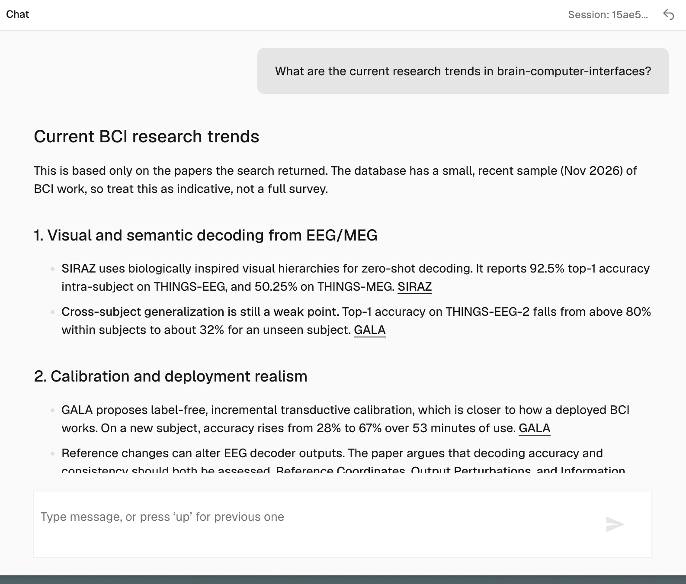
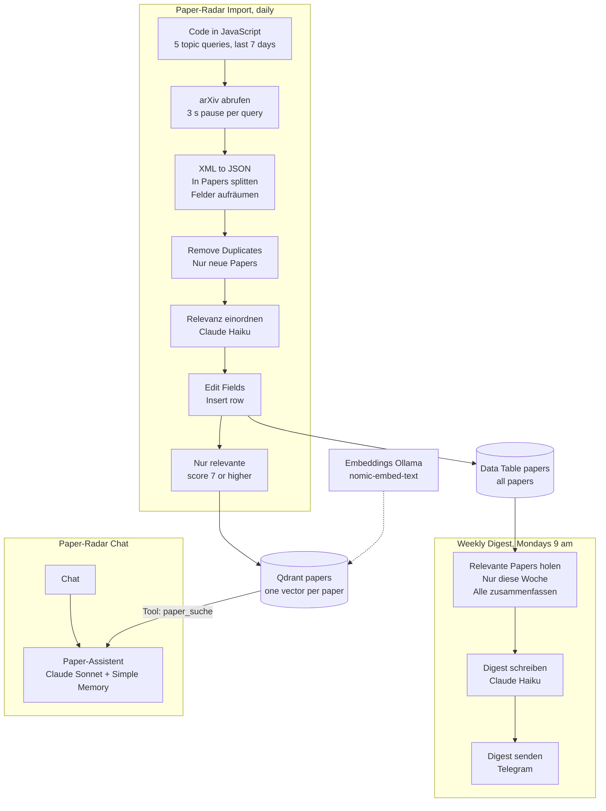

# Paper-Radar

A RAG system for scientific literature, built with n8n. Every day it fetches new arXiv papers on general AI, AI in society, AI in medicine, computational neuroscience, neurotech & BCI, has Claude rate and summarize them and send a weekly digest grouped by topic via Telegram. A chat workflow answers questions about the stored papers in a chat, with sources.

## Architecture

Node names are in German, as in the workflow files.

| Workflow | File | Screenshot |
| --- | --- | --- |
| Paper-Radar Import | `workflows/import.json` | [docs/import.png](docs/import.png) |
| Weekly Digest | `workflows/digest.json` | [docs/digest.png](docs/digest.png) |
| Paper-Radar Chat | `workflows/chat.json` | [docs/chat.png](docs/chat.png) |

### Weekly digest in Telegram

## Setup

1. n8n runs in Docker as a container named `n8n`.
2. Start Qdrant and Ollama: `bash docker/setup.sh`
3. Create credentials in n8n: Qdrant (`http://qdrant:6333`), Ollama (`http://ollama:11434`), Anthropic, Telegram (your own bot via `@BotFather`).
4. Create a Data Table `papers` with the columns `arxiv_id`, `titel`, `autoren`, `veroeffentlicht`, `link`, `score` (Number), `kategorie`, `zusammenfassung`, `erfasst`, `abstract`.
5. Import the three workflows from `workflows/` ("…" → "Import from File"), assign credentials and the Data Table, and replace `DEINE_CHAT_ID` in "Digest senden" with your Telegram chat ID.
6. Activate Import and Digest. Use the chat via "Open chat" in the "Paper-Radar Chat" workflow.

The prompts and the code for the topic queries are also available as files in `prompts/`.

## Limitations

- Abstracts only, no full texts.
- For large categories such as cs.AI, each query returns at most 40 papers.
- The relevance rating relies on LLM judgement.

## Data

Metadata and abstracts come from [arXiv](https://arxiv.org/). The repository contains no stored papers, only the workflows.

Thank you to arXiv for use of its open access interoperability.
